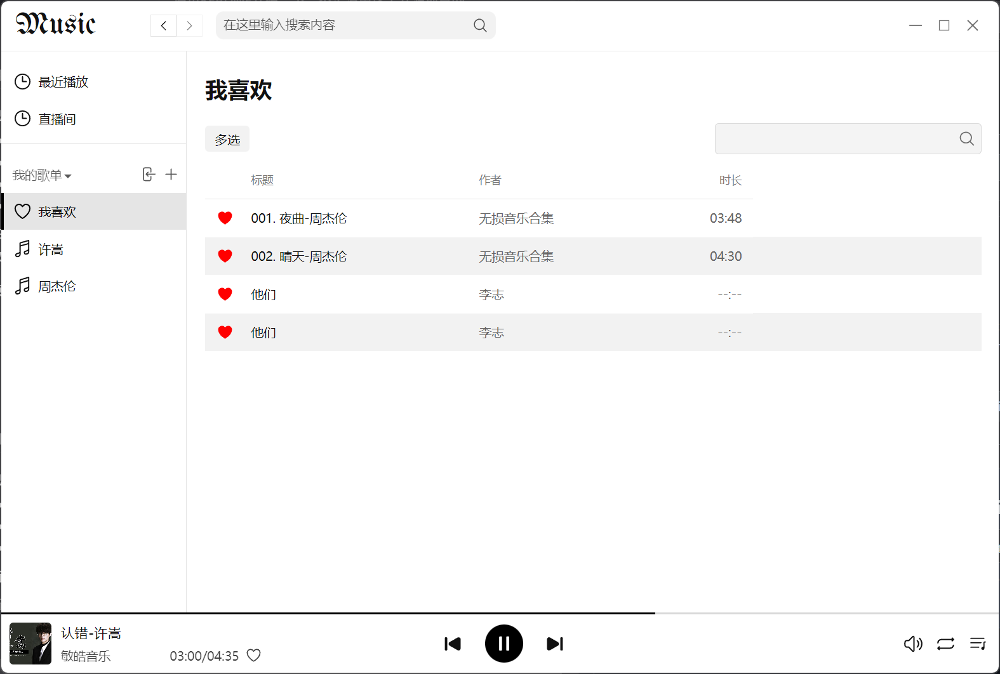

# bilibilimusic

一个面向 B 站内容的桌面音乐播放器，提供纯音乐与直播两个版本。

## 两个分支

| 分支 | 版本 | 功能 |
| --- | --- | --- |
| [main](https://github.com/1zzy2/bilibilimusic/tree/main) | 纯音乐版 | 音乐搜索、歌单、收藏和最近播放 |
| [live](https://github.com/1zzy2/bilibilimusic/tree/live) | 直播版 | 包含音乐功能，并支持直播搜索和视频播放 |

当前分支：**main（纯音乐版）**。

## 功能

- 搜索 B 站音乐，播放视频中的音频。
- 管理歌单和收藏，查看最近播放记录。
- 支持歌单内搜索、多选、拖拽排序和分 P 展开。

## 本地运行

需要 Node.js、npm 和 Git。

```bash
git clone https://github.com/1zzy2/bilibilimusic.git
cd bilibilimusic
npm ci
npm start
```

使用直播版时，在安装依赖前切换分支：

```bash
git switch live
```

打包桌面程序：

```bash
npm run package
```

## 许可证与致谢

本项目包含 [MusicFreeDesktop](https://github.com/maotoumao/MusicFreeDesktop) 的代码，并在此基础上开发上述功能。保留原作者版权说明，使用 AGPL-3.0 许可证，详见 [LICENSE](LICENSE)。

## 界面截图

### 音乐与收藏



### 直播播放（live 分支）


截图来自 live 分支；main 分支提供纯音乐功能，不包含直播入口。
